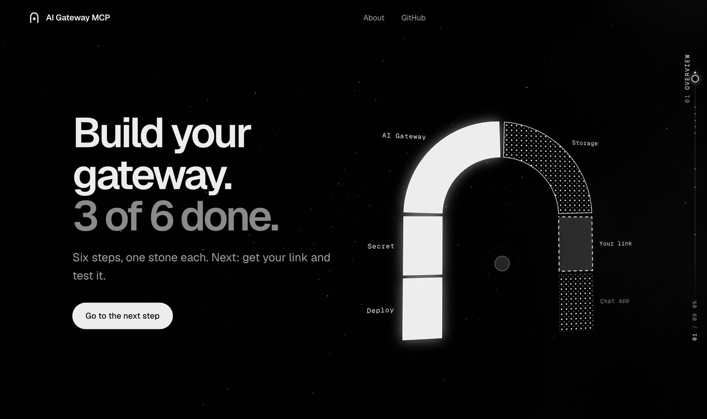
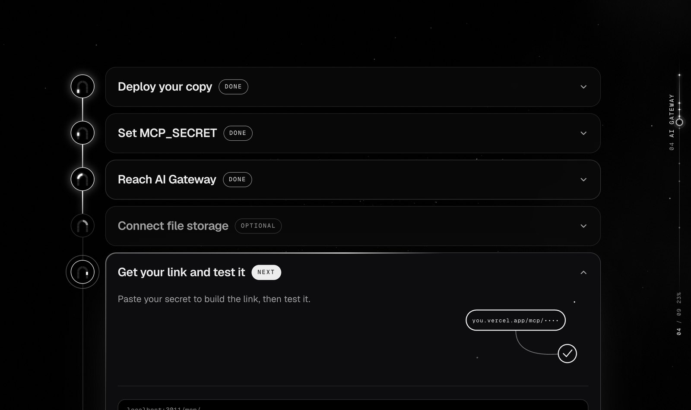
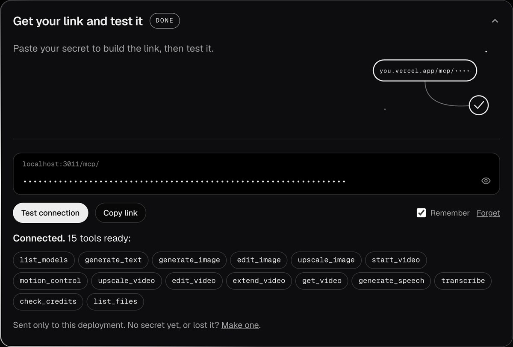
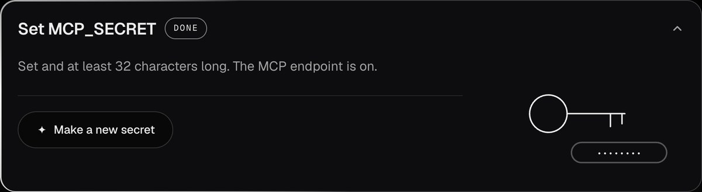
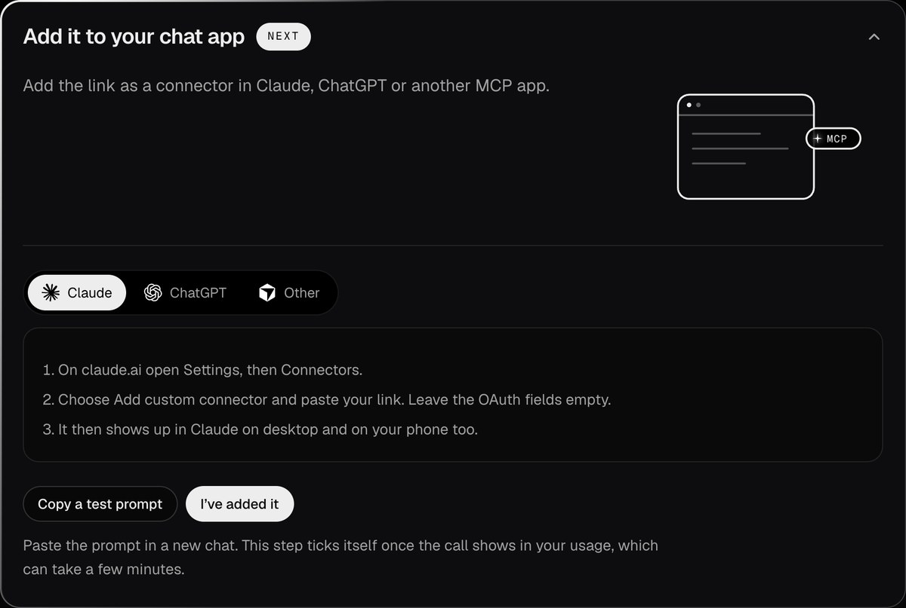
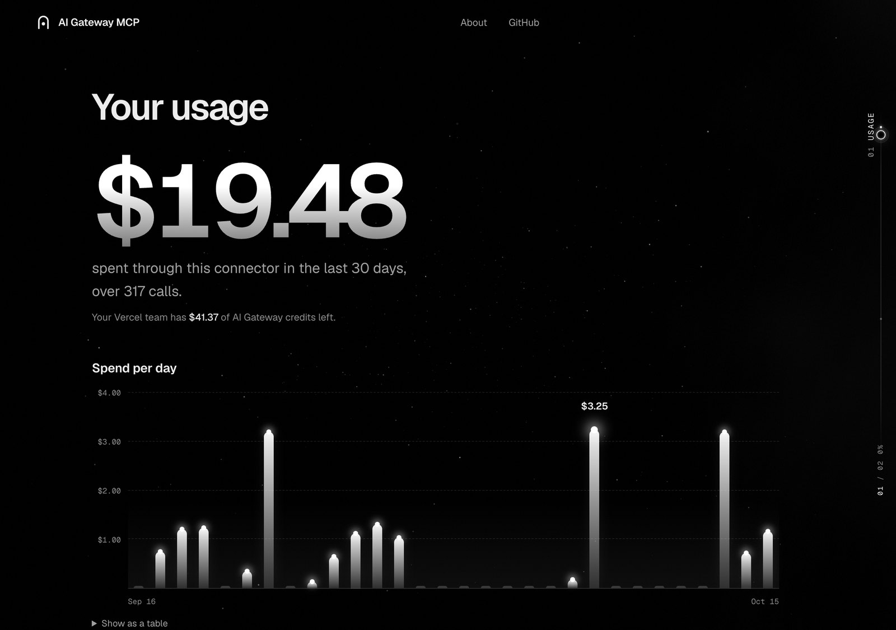

<p align="center">
  
</p>

<p align="center">
  <a href="https://vercel.com/new/clone?repository-url=https%3A%2F%2Fgithub.com%2Farmulee%2Fai-gateway-mcp&project-name=gateway-mcp&repository-name=gateway-mcp&env=MCP_SECRET&envDescription=A%20long%20random%20secret%20%28at%20least%2032%20characters%29.%20It%20becomes%20part%20of%20your%20connector%20URL%2C%20so%20keep%20it%20private.%20Generate%20one%20with%3A%20openssl%20rand%20-hex%2032&envLink=https%3A%2F%2Fgithub.com%2Farmulee%2Fai-gateway-mcp%23mcp_secret&stores=%5B%7B%22type%22%3A%22blob%22%2C%22access%22%3A%22private%22%7D%5D"></a>
</p>

<p align="center">
  <b>One click, and you are done.</b><br>
  <sub>Vercel copies this repo to your account, makes your private storage and asks for one secret. Your copy then walks you through the rest.</sub>
</p>

<p align="center">
  
  
  
  
</p>

<p align="center">
  <a href="#what-you-can-make">What you can make</a> ·
  <a href="#how-it-works">How it works</a> ·
  <a href="#get-started">Get started</a> ·
  <a href="#what-it-costs">What it costs</a> ·
  <a href="#tools">Tools</a> ·
  <a href="#keep-it-safe">Keep it safe</a>
</p>

<br>

**Your chat app already writes. Now it can make pictures, video and voice too.** Add this connector to Claude, ChatGPT or any MCP app and it can use every model on [Vercel AI Gateway](https://vercel.com/docs/ai-gateway): Veo, Kling, FLUX, Nano Banana, GPT Image, Seedance and hundreds more. You run your own copy on your own Vercel account, so every call is paid from your own credits at the provider's own price. No subscription, no API key, no extra fees.

## What you can make

Ask in plain words. Your chat does the thinking and the writing with everything it already knows about you; the connector makes the pictures, the video and the voice.

<table>
  <tr>
    <td width="50%" valign="top">
      <h3>Shoot a short film</h3>
      <p><i>"Write a one-minute sci-fi short, storyboard it, then film every scene with sound."</i></p>
      <p>Your chat writes the script and plans each shot. The connector draws the storyboard and films the scenes.</p>
      <sub><code>generate_image</code> <code>start_video</code> <code>get_video</code></sub><br>
      <b>10 scenes with sound: $12.00</b> <sub>on Veo 3.1 Fast</sub>
    </td>
    <td width="50%" valign="top">
      <h3>Write and illustrate a book</h3>
      <p><i>"Write a 12-chapter bedtime story about a fox who collects stars, and paint every chapter in watercolour."</i></p>
      <p>Your chat writes the story. The connector paints the cover and a picture for each chapter, in one style.</p>
      <sub><code>generate_image</code> <code>edit_image</code></sub><br>
      <b>12 pictures: $1.61</b> <sub>on Nano Banana Pro</sub>
    </td>
  </tr>
  <tr>
    <td width="50%" valign="top">
      <h3>Turn it into an audiobook</h3>
      <p><i>"Read chapter one aloud in a warm, slow voice, like a bedtime story."</i></p>
      <p>The connector narrates the text and hands back an audio file you can play right in the chat.</p>
      <sub><code>generate_speech</code></sub><br>
      <b>A 2,000-word chapter: about $0.33</b> <sub>on TTS-1 HD</sub>
    </td>
    <td width="50%" valign="top">
      <h3>Shoot a product</h3>
      <p><i>"Take this photo of my mug, put it on white marble in morning light, then make a slow turntable clip."</i></p>
      <p>The connector edits your own photo into new shots, then films a short clip from the best one.</p>
      <sub><code>edit_image</code> <code>start_video</code> <code>get_video</code></sub><br>
      <b>4 shots and a 5-second clip: $0.66</b> <sub>on FLUX Kontext Pro and Veo 3.1 Fast</sub>
    </td>
  </tr>
  <tr>
    <td width="50%" valign="top">
      <h3>Make anyone dance</h3>
      <p><i>"Make the character in this picture do the dance in this video."</i></p>
      <p>The connector copies the moves from a reference video onto your character, frame by frame.</p>
      <sub><code>motion_control</code> <code>get_video</code></sub><br>
      <b>A 10-second dance: $1.26</b> <sub>on Kling 3.0 Motion Control</sub>
    </td>
    <td width="50%" valign="top">
      <h3>Run a month of posts</h3>
      <p><i>"Plan 30 days of posts for my bakery, write the captions, and make a picture for each day."</i></p>
      <p>Your chat plans the month. The connector makes a picture for every day and vertical clips for the big ones.</p>
      <sub><code>generate_image</code> <code>start_video</code> <code>get_video</code></sub><br>
      <b>30 pictures and 8 clips: $10.43</b> <sub>on Nano Banana Pro and Veo 3.1 Fast</sub>
    </td>
  </tr>
  <tr>
    <td width="50%" valign="top">
      <h3>Turn a recording into notes</h3>
      <p><i>"Transcribe this meeting with timestamps, then give me the decisions and who owns what."</i></p>
      <p>The connector writes down every word; your chat turns it into notes, subtitles or a translation.</p>
      <sub><code>transcribe</code></sub><br>
      <b>A 20-minute recording: $0.12</b> <sub>on Whisper</sub>
    </td>
    <td width="50%" valign="top">
      <h3>Pick the right model</h3>
      <p><i>"Which video model is cheapest for an 8-second clip that still looks good?"</i></p>
      <p>The connector lists every model with its AI Gateway catalog price, so your chat can choose for you, or compare a few side by side.</p>
      <sub><code>list_models</code> <code>check_credits</code></sub><br>
      <b>Free</b> <sub>reading the catalog costs nothing</sub>
    </td>
  </tr>
</table>

<sub>Costs are AI Gateway catalog prices from October 2026, for the example quantities shown. They are examples, not quotes: the provider's bill can differ from the catalog (see <a href="#what-it-costs">What it costs</a>), and each call reports what it actually cost. Ask <code>list_models</code> for today's catalog.</sub>

## How it works

<p align="center">
  
</p>

1. **You ask in chat.** Claude, ChatGPT or any app that speaks MCP picks the right tool.
2. **Your own copy answers.** It runs on your Vercel account and checks your secret link.
3. **AI Gateway runs the model,** billed to your own credits at the provider's price. No API key: your copy signs in with Vercel's own token.

> **What is MCP?** The Model Context Protocol is how chat apps plug in outside tools. This project is one of those tools: once you add its link, your chat app can make things with any model on AI Gateway.

## Get started

You need a [Vercel](https://vercel.com) account and a GitHub, GitLab or Bitbucket account.

<table>
  <tr>
    <td width="33%" valign="top">
      <h3>1. Deploy</h3>
      <p>Click the button. Vercel copies the repo, makes your private storage and asks for <a href="#mcp_secret"><code>MCP_SECRET</code></a> (your copy can make one for you).</p>
    </td>
    <td width="33%" valign="top">
      <h3>2. Open your copy</h3>
      <p>Go to <code>https://&lt;your-project&gt;.vercel.app</code>. It checks itself, builds your link and tests it.</p>
    </td>
    <td width="33%" valign="top">
      <h3>3. Add it to your chat</h3>
      <p>In Claude: Settings → Connectors → Add custom connector, paste the link. ChatGPT and others take it as a custom MCP server.</p>
    </td>
  </tr>
</table>

<p align="center">
  <a href="https://vercel.com/new/clone?repository-url=https%3A%2F%2Fgithub.com%2Farmulee%2Fai-gateway-mcp&project-name=gateway-mcp&repository-name=gateway-mcp&env=MCP_SECRET&envDescription=A%20long%20random%20secret%20%28at%20least%2032%20characters%29.%20It%20becomes%20part%20of%20your%20connector%20URL%2C%20so%20keep%20it%20private.%20Generate%20one%20with%3A%20openssl%20rand%20-hex%2032&envLink=https%3A%2F%2Fgithub.com%2Farmulee%2Fai-gateway-mcp%23mcp_secret&stores=%5B%7B%22type%22%3A%22blob%22%2C%22access%22%3A%22private%22%7D%5D"></a>
</p>

Then set a **spend budget** in the Vercel dashboard (AI Gateway → Budgets). It is the real limit on what your link can ever spend.

### Your copy comes with its own setup page

Open your copy and it shows where you are: an arch of six stones, one per step. Set stones glow, the next one breathes, and clicking a stone opens its step.

<p align="center">
  
</p>

<table>
  <tr>
    <td width="50%" valign="top">
      
      <p><b>One step at a time.</b> Done steps fold away and the next one opens with exactly what to do.</p>
    </td>
    <td width="50%" valign="top">
      
      <p><b>Your link, tested.</b> Paste your secret, and your copy builds the link and tests it against itself.</p>
    </td>
  </tr>
  <tr>
    <td width="50%" valign="top">
      
      <p><b>A secret in one click.</b> Made in your browser and never sent anywhere, with links straight to your project's settings.</p>
    </td>
    <td width="50%" valign="top">
      
      <p><b>Into your chat app.</b> Steps for Claude, ChatGPT and any other MCP app, and a test prompt to try it.</p>
    </td>
  </tr>
</table>

Once every step is done, the guide steps aside for good. From then on your page opens on the brand and goes straight to your usage. If anything comes undone later (say `MCP_SECRET` is removed), the guide comes back by itself.

<p align="center">
  
</p>

<p align="center">
  
  <br><sub>Your usage, unlocked with your secret (shown here with sample numbers): what this connector spent, day by day, by model and by chat app.</sub>
</p>

## What it costs

Nothing from this project: it is free and MIT licensed, with no plan and no fee. You pay what each provider charges, with no markup, through your own AI Gateway credits, and every Vercel team gets free monthly credits for a set of models. In Vercel's words ([AI Gateway pricing](https://vercel.com/docs/ai-gateway/pricing)):

> AI Gateway charges no markup and no platform fee on tokens. You pay the provider's list price on a pay-as-you-go basis.

| You ask for | Model | Catalog price |
| --- | --- | --- |
| A picture | `recraft/recraft-v4.1-flash` | $0.007 |
| A picture | `google/gemini-3-pro-image` (Nano Banana Pro) | $0.134 |
| An edit of your own photo | `bfl/flux-kontext-pro` | $0.04 |
| 8 seconds of video, with sound | `google/veo-3.1-fast-generate-001` | $1.20 |
| 10 seconds of motion copied onto a character | `klingai/kling-v3.0-motion-control` | $1.26 |
| 1,000 words read aloud | `openai/tts-1-hd` | about $0.17 |
| An hour of speech written down | `openai/whisper-1` | $0.36 |

<sub>From the AI Gateway catalog, October 2026. The catalog is a guide, not the bill: the provider's charge can differ. <code>bfl/flux-3-image</code> lists $0.024 for a 1024x1024 picture, but Black Forest Labs billed $0.048, which AI Gateway passed on with no surcharge. Each call reports its actual cost; ask <code>list_models</code> for today's catalog.</sub>

This project is not made by or affiliated with Vercel. Version 1 means you run your own copy, so setup is as short as I could make it: the goal is for everyone to use AI at the price providers actually set.

## Tools

Your chat app picks these for you; you never have to name them. Every tool returns readable errors that name the model: unknown model, not enough credits, video not on your plan, provider errors.

<table>
  <tr>
    <td width="50%" valign="top">
      <h4>Pictures</h4>
      <code>generate_image</code> makes images from words, with image models (FLUX, GPT Image, Recraft) and image-capable LLMs (Nano Banana).<br><br>
      <code>edit_image</code> changes your own images: remove a background, restyle, extend the canvas, combine several.<br><br>
      <code>upscale_image</code> makes an image sharper and larger (Topaz).
    </td>
    <td width="50%" valign="top">
      <h4>Video</h4>
      <code>start_video</code> films from words, from a picture, from a first to a last frame, or with your characters as references, with sound if you like.<br><br>
      <code>motion_control</code> copies the moves in a video onto a character (Kling).<br><br>
      <code>edit_video</code>, <code>extend_video</code> change or continue a clip (Grok Imagine).<br><br>
      <code>upscale_video</code> sharpens and enlarges a clip (Topaz).<br><br>
      <code>get_video</code> fetches any of them when ready.
    </td>
  </tr>
  <tr>
    <td width="50%" valign="top">
      <h4>Voice</h4>
      <code>generate_speech</code> reads text aloud for narration and voice-overs (OpenAI, Gemini, Fish Audio, MAI Voice).<br><br>
      <code>transcribe</code> writes down the speech in an audio or video file, with timestamps if you like.
    </td>
    <td width="50%" valign="top">
      <h4>Models and your account</h4>
      <code>list_models</code> lists every model with its AI Gateway catalog price.<br><br>
      <code>generate_text</code> asks another model for text, to compare answers.<br><br>
      <code>check_credits</code> shows your credits and this connector's spend.<br><br>
      <code>list_files</code> finds the pictures, videos and audio you made before.
    </td>
  </tr>
</table>

<details>
<summary><b>Every tool and its inputs</b></summary>

<br>

| Tool | What it does |
| --- | --- |
| `list_models({ type?, query? })` | Lists the models in the AI Gateway catalog with their type (`text`, `image`, `video`, `speech`, `transcription`), capabilities (`t2v`, `i2v`, …) and catalog price. |
| `generate_text({ model, prompt, system?, max_tokens? })` | Generates text. Returns the text plus its cost when AI Gateway reports one. |
| `generate_image({ model, prompt, size_or_aspect?, n?, estimate_only? })` | Works with image models (`bfl/flux-2-pro`, `openai/gpt-image-2`, …) and image-capable LLMs (`google/gemini-3-pro-image`). Images come back inline, and as expiring links when Blob is connected. |
| `edit_image({ model, prompt, image_urls, mask_url?, size_or_aspect?, n? })` | Changes existing images from an instruction. Works with edit-capable image models (`bfl/flux-kontext-pro`, `openai/gpt-image-2`, …) and image-capable LLMs. Takes https links; links this server returned work too, because it downloads the inputs itself. |
| `upscale_image({ image_url, model?, prompt? })` | Makes an image sharper and larger. Uses `topaz/wonder-3.5` unless you name another model. |
| `start_video({ model, prompt, image_url?, end_image_url?, reference_urls?, duration?, aspect_ratio?, sound?, estimate_only? })` | Starts a video job and returns a `job_id` right away: text-to-video, image-to-video, first-to-last frame, or reference-to-video with up to 4 pictures or clips of your characters. |
| `motion_control({ image_url, video_url, prompt?, orientation?, quality?, keep_sound?, estimate_only? })` | Makes the character in a picture move like the person in a reference video (Kling motion control). |
| `upscale_video({ video_url, resolution?, model?, estimate_only? })` | Makes a video sharper and larger and cleans up noise (Topaz Proteus by default). |
| `edit_video({ video_url, prompt, estimate_only? })` | Changes an existing video from an instruction (Grok Imagine Video, up to 720p). |
| `extend_video({ video_url, prompt, duration?, estimate_only? })` | Continues a video from its last frame (Grok Imagine Video). |
| `estimate_only: true` | On `generate_image` and the video tools: returns the price from the AI Gateway catalog instead of running. Nothing is generated or charged. Often a range, because resolution or audio is left to the model's defaults; token-priced models (e.g. `openai/gpt-image-2`, Seedance 2) have no estimate. The provider can bill more than the catalog price: `bfl/flux-3-image` is listed at $0.024 for 1024x1024 but was billed $0.048. |
| `get_video({ job_id })` | For every video tool above: reports whether the job is still generating. When it finishes, the video is saved to your Blob store and you get an expiring link; call it again later for a fresh one. |
| `generate_speech({ model, text, voice?, instructions?, speed?, language?, format? })` | Turns text into speech (`openai/tts-1-hd`, `google/gemini-3.8-flash-tts`, `fish-audio/s2-pro`, …). The audio comes back inline and as an expiring link. |
| `transcribe({ model, audio_url, timestamps? })` | Turns speech in an audio or video file (up to 25 MB) into text, optionally with timestamps. |
| `check_credits()` | Shows the team's AI Gateway credits and what this connector spent in the last 30 days. |
| `list_files({ kind?, limit? })` | Lists the pictures, videos and audio this connector made, newest first, with fresh expiring links. |

</details>

## Keep it safe

- **Your link works like a password that spends money.** Anyone who has it can use your AI Gateway credits. Keep it private.
- **Set an AI Gateway budget.** Only Vercel's budget limits your total spend.
- **If the link leaks, change `MCP_SECRET`** in Project Settings → Environment Variables and redeploy. The old link stops working at once.
- **Your usage is yours.** Anyone can open your setup page, but the numbers only appear for someone who has your secret.

<details>
<summary><b>More on security and costs</b></summary>

<br>

- **Your connector URL works like a password that spends money.** Anyone who has it can use your AI Gateway credits and generate content under your Vercel account.
- **Set an AI Gateway budget.** This server caps each call (`MAX_VIDEO_SECONDS`, `MAX_IMAGES_PER_CALL`, `MAX_SPEECH_CHARACTERS`, `ALLOWED_MODELS`), but only Vercel's budget limits your total spend. Tools that start from your own video (`motion_control`, `upscale_video`, `edit_video`) follow its length, which the per-call caps cannot see.
- **Rotate the secret if the URL leaks.** Change `MCP_SECRET` and redeploy. The old URL stops working right away, and any unfinished video jobs are abandoned.
- **Optional: rate-limit the endpoint.** Guessing is hopeless, but every wrong request still counts toward your project's usage. If your plan includes Vercel Firewall rate limiting, add a rule for paths starting with `/mcp/` (for example, by IP). Do not turn on Attack Challenge Mode for it: Claude's and ChatGPT's servers cannot solve the challenge, so your connector would stop working.
- **Files are private, but links are not.** Pictures, videos and audio are stored in a private Blob store. Anyone who holds one of the links returned in chat can open that file until the link expires (`SIGNED_URL_TTL_HOURS`).
- **Usage stats need the secret.** `POST /api/stats` checks it in constant time and answers 404 otherwise. Remembering the secret in a browser lets anyone using that browser see your usage; "Forget" removes it.
- **Logs:** this app never logs the secret or request URLs. Vercel's own request logs record request paths, so members of your Vercel team can see the secret there.
- Generated media is stored exactly as the provider returns it. Watermarks and metadata are never removed.

</details>

## Reference

### MCP_SECRET

Your connector link is your deployment's address plus the secret. The setup page builds it in your browser:

```
https://<your-project>.vercel.app/mcp/<MCP_SECRET>
```

`MCP_SECRET` is a random value of at least 32 characters, for example the output of `openssl rand -hex 32`. Use URL-safe characters only; hex is ideal. The setup page can also make one for you.

A random 64-character hex secret holds 256 bits: guessing it over the network is not possible in practice, and every wrong guess gets the same 404 as any unknown URL, compared in constant time. Secrets typed by hand are the weak spot, so the endpoint also stays off when the secret has fewer than 8 different characters or repeats one short block (`aaaa…`, `passwordpassword…`).

claude.ai custom connectors only support OAuth or no auth, and they can't send custom headers, so the secret goes in the URL path. If `MCP_SECRET` is missing or shorter than 32 characters, the MCP endpoint is disabled. A wrong secret gets the same 404 page as any unknown URL.

<details>
<summary><b>Configuration</b></summary>

<br>

| Variable | Default | Purpose |
| --- | --- | --- |
| `MCP_SECRET` | none (required) | Secret part of the connector URL. Must be at least 32 characters. |
| `MAX_VIDEO_SECONDS` | `8` | Longest video `start_video` and `extend_video` accept. |
| `MAX_IMAGES_PER_CALL` | `4` | Highest `n` that `generate_image` and `edit_image` accept. |
| `MAX_SPEECH_CHARACTERS` | `5000` | Longest text `generate_speech` accepts in one call. |
| `ALLOWED_MODELS` | empty (all models) | Comma-separated allowlist of model ids. |
| `SIGNED_URL_TTL_HOURS` | `24` | How long file links stay valid. The maximum is 168 (7 days). |
| `AI_GATEWAY_API_KEY` | unset | Optional. Use it for local development. When set, it replaces the OIDC token. |

Vercel sets the Blob variables (`BLOB_STORE_ID`, plus `BLOB_READ_WRITE_TOKEN` as a fallback) and `VERCEL_OIDC_TOKEN` automatically when the store is connected. Without a Blob store, text, pictures and voice still work inline; video and file links need one. Create a private Blob store under the project's Storage tab, connect it and redeploy. The setup page links there.

</details>

<details>
<summary><b>Local development</b></summary>

<br>

```bash
npm install
vercel link && vercel env pull   # pulls MCP_SECRET, Blob and a 12-hour OIDC token into .env.local
# or put AI_GATEWAY_API_KEY=... and MCP_SECRET=... in .env.local
npm run dev
```

Test the server with the MCP Inspector:

```bash
npx @modelcontextprotocol/inspector@latest
```

Choose **Streamable HTTP** and connect to `http://localhost:3000/mcp/<MCP_SECRET>`.

Two development-only addresses preview states you cannot reach without a deployment: `/?preview-open` shows the page as it looks once setup is done, and `/?sample-stats` fills the usage with sample numbers.

</details>

<details>
<summary><b>How it works inside</b></summary>

<br>

- **Setup page:** `/` checks the deployment live and guides each step, then hides the guide once every required step is done (a `gateway-open` cookie, ignored whenever a server check fails). Black and white, drawn in code, with motion that rests finished under reduced motion. `/setup` redirects there.
- **Usage stats:** every call from this server carries AI Gateway tags (`ai-gateway-mcp`, `tool:<name>`, `client:<app>`, the app guessed from its User-Agent). The setup page reads AI Gateway's own spend report filtered by those tags, so there is no database.
- **Stack:** Next.js (App Router) and TypeScript. MCP is served over Streamable HTTP using [`mcp-handler`](https://github.com/vercel/mcp-handler) v2, and model calls go through the [AI SDK](https://ai-sdk.dev) with the AI Gateway provider.
- **Secret check:** `proxy.ts` rejects a wrong secret before routing by rewriting it to the standard 404 page. The route handler then checks the secret again, in constant time.
- **Media in, media out:** files you give a tool are downloaded by the server (https only, size-capped), so this server's own private links work as input. Video jobs send theirs as links, since AI Gateway keeps a job's start request small.
- **Video jobs:** no database. Each `job_id` holds the model and the AI Gateway job id, signed with a key derived from `MCP_SECRET` so it can't be forged.

</details>

## License

MIT
