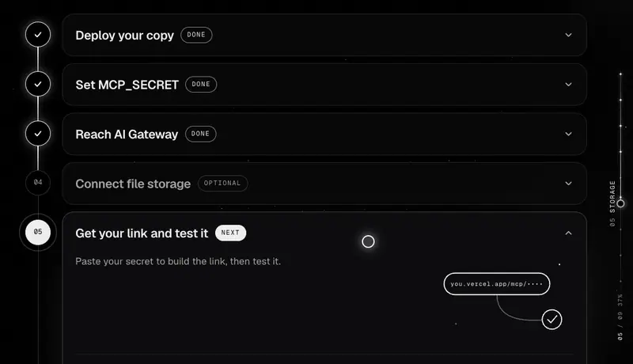
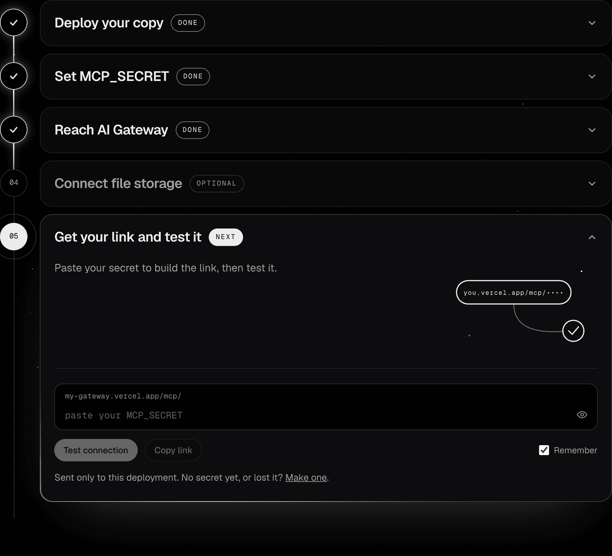
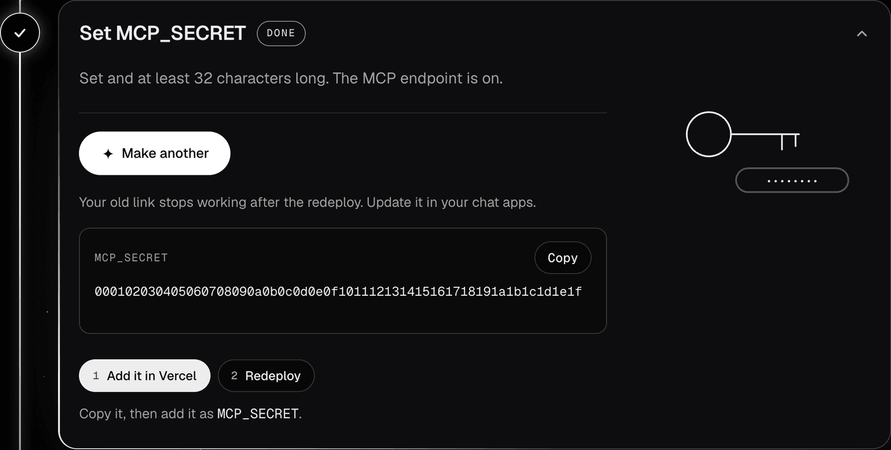
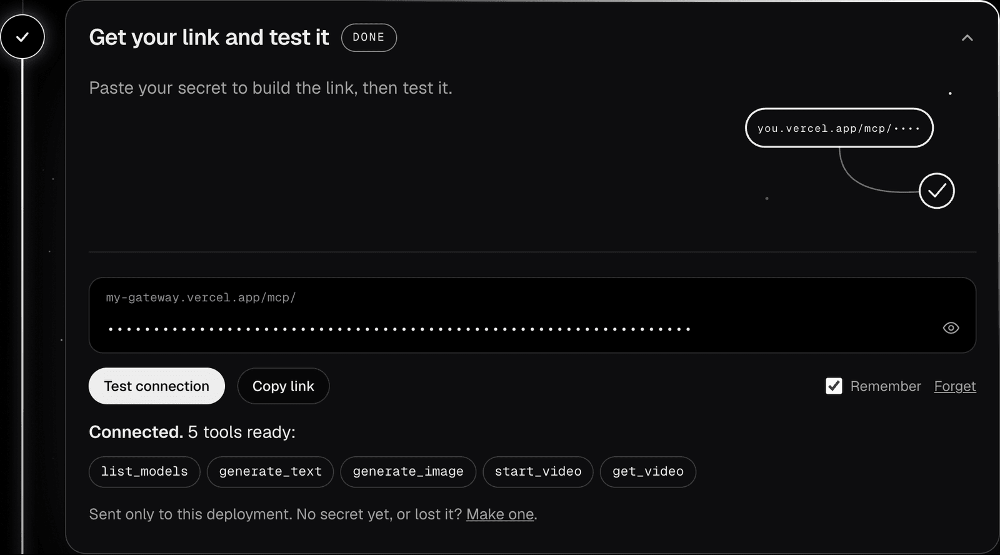
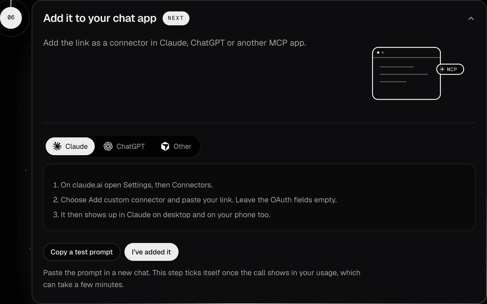

<p align="center">
  
</p>

<p align="center">
  <a href="https://vercel.com/new/clone?repository-url=https%3A%2F%2Fgithub.com%2Farmulee%2Fai-gateway-mcp&project-name=gateway-mcp&repository-name=gateway-mcp&env=MCP_SECRET&envDescription=A%20long%20random%20secret%20%28at%20least%2032%20characters%29.%20It%20becomes%20part%20of%20your%20connector%20URL%2C%20so%20keep%20it%20private.%20Generate%20one%20with%3A%20openssl%20rand%20-hex%2032&envLink=https%3A%2F%2Fgithub.com%2Farmulee%2Fai-gateway-mcp%23mcp_secret&stores=%5B%7B%22type%22%3A%22blob%22%2C%22access%22%3A%22private%22%7D%5D"></a>
</p>

<p align="center">
  
  
  
  
</p>

<p align="center">
  <a href="#set-up">Set up</a> ·
  <a href="#the-setup-page">The setup page</a> ·
  <a href="#tools">Tools</a> ·
  <a href="#configuration">Configuration</a> ·
  <a href="#security-and-costs">Security</a> ·
  <a href="#local-development">Local development</a>
</p>

<br>

AI Gateway MCP is an open-source MCP server that lets Claude, ChatGPT and other MCP clients call any model on [Vercel AI Gateway](https://vercel.com/docs/ai-gateway), for text, images and video.

You deploy your own copy to your Vercel account, so every call is billed to **your own AI Gateway credits**. The deployment authenticates to AI Gateway with its OIDC token, so you don't need an API key, and nobody else ever holds your money or keys.

This repo is the app you deploy: the MCP server and its setup page. The project's website lives in [armulee/ai-gateway-mcp-landing](https://github.com/armulee/ai-gateway-mcp-landing).

<p align="center">
  
</p>

## Why Vercel AI Gateway

This project is not made by or affiliated with Vercel. It uses AI Gateway because of how it prices models. In Vercel's own words ([AI Gateway pricing](https://vercel.com/docs/ai-gateway/pricing)):

> AI Gateway charges no markup and no platform fee on tokens. You pay the provider's list price on a pay-as-you-go basis.

- **No plan.** There is no subscription. You top up AI Gateway credits on your own Vercel account (or turn on auto top-up) and each request uses what that model costs. Every team also gets free monthly credits for a set of models.
- **Every kind of model.** Text, image and video models from dozens of providers, all behind one connector.
- **Free and open source.** I charge nothing and never see your money or keys. The code is MIT licensed. Version 1 means you run your own copy, so I made setup as short as I could: the goal is for everyone to use AI at the price providers actually set.

## What you need

- A [Vercel](https://vercel.com) account. Your copy of this project and your credits live there.
- A GitHub, GitLab or Bitbucket account. The Deploy button copies the code into it.
- AI Gateway credits for the models you use (free monthly credits cover a set of models).

## Set up

1. **Click Deploy.** Vercel copies this repo to your GitHub, GitLab or Bitbucket account and asks for `MCP_SECRET` (see [below](#mcp_secret)). It also creates a **private Vercel Blob store** and connects it to the project, so there is nothing else to configure.
2. **Open your deployment** at `https://<your-project>.vercel.app`. Its home page is a step-by-step guide that checks your copy (secret, AI Gateway, Blob), shows which steps are done and tells you what to do next.
3. **Paste your secret** there to build your connector URL, then click **Test connection**. The URL is assembled in your browser and has this form:
   ```
   https://<your-project>.vercel.app/mcp/<MCP_SECRET>
   ```
4. **Add it as a connector:**
   - **Claude:** Settings → Connectors → Add custom connector. Paste the URL and leave authentication empty.
   - **ChatGPT and other MCP clients:** add a custom MCP server (Streamable HTTP) using the same URL.
5. **Set an AI Gateway budget** in the Vercel dashboard (AI Gateway → budgets). This budget is the real spending limit.

### MCP_SECRET

`MCP_SECRET` is a random value of at least 32 characters, for example the output of `openssl rand -hex 32`. Use URL-safe characters only; hex is ideal. The setup page can also generate one for you.

claude.ai custom connectors only support OAuth or no auth, and they can't send custom headers, so the secret goes in the URL path. If `MCP_SECRET` is missing or shorter than 32 characters, the MCP endpoint is disabled. A wrong secret gets the same 404 page as any unknown URL.

## The setup page

Every deployment's home page is a guide to its own setup. It checks your copy live, ticks off what is done and keeps only the step you are on open.

<p align="center">
  
</p>

<p align="center">
  
</p>

<table>
  <tr>
    <td width="50%" valign="top">
      
      <p><b>One step at a time.</b> Done steps fold to a line; the next one opens with what to do.</p>
    </td>
    <td width="50%" valign="top">
      
      <p><b>A secret in one click.</b> Made in your browser, never sent anywhere, with links straight to your project's environment variables.</p>
    </td>
  </tr>
  <tr>
    <td width="50%" valign="top">
      
      <p><b>Your link, tested.</b> Paste the secret to build the URL, then test it against your own deployment.</p>
    </td>
    <td width="50%" valign="top">
      
      <p><b>Into your chat app.</b> Steps for Claude, ChatGPT and any other MCP app, and a test prompt to try it.</p>
    </td>
  </tr>
</table>

## Tools

| Tool | What it does |
| --- | --- |
| `list_models({ type?, query? })` | Lists the models in the AI Gateway catalog with their type, capabilities (`t2v`, `i2v`, …) and price. |
| `generate_text({ model, prompt, system?, max_tokens? })` | Generates text. Returns the text plus its cost when AI Gateway reports one. |
| `generate_image({ model, prompt, size_or_aspect?, n? })` | Works with image models (`bfl/flux-2-pro`, `openai/gpt-image-2`, …) and with image-capable LLMs (`google/gemini-3-pro-image`). Images come back inline. They are also saved to Blob and returned as expiring links. |
| `start_video({ model, prompt, image_url?, duration?, aspect_ratio? })` | Starts an asynchronous AI Gateway video job and returns a `job_id` right away. |
| `get_video({ job_id })` | Reports whether the job is still generating. When it finishes, the video is copied into your Blob store and you get an expiring link. Call it again later for a fresh link. |

Errors are written to be readable and always name the model. They cover unknown models, missing credits, video not being available to your team, authentication failures and provider errors.

## Configuration

| Variable | Default | Purpose |
| --- | --- | --- |
| `MCP_SECRET` | none (required) | Secret part of the connector URL. Must be at least 32 characters. |
| `MAX_VIDEO_SECONDS` | `8` | Longest video `start_video` accepts. |
| `MAX_IMAGES_PER_CALL` | `4` | Highest `n` that `generate_image` accepts. |
| `ALLOWED_MODELS` | empty (all models) | Comma-separated allowlist of model ids. |
| `SIGNED_URL_TTL_HOURS` | `24` | How long file links stay valid. The maximum is 168 (7 days). |
| `AI_GATEWAY_API_KEY` | unset | Optional. Use it for local development. When set, it replaces the OIDC token. |

Vercel sets the Blob variables (`BLOB_STORE_ID`, plus `BLOB_READ_WRITE_TOKEN` as a fallback) and `VERCEL_OIDC_TOKEN` automatically when the store is connected. If your project has no Blob store (for example, you imported the repo yourself), text and images still work; for video and image links, create a private Blob store under the project's Storage tab, connect it and redeploy. The setup page links there.

## Security and costs

**Read this before sharing anything.**

- **Your connector URL works like a password that spends money.** Anyone who has it can use your AI Gateway credits and generate content under your Vercel account. Keep it private.
- **Set an AI Gateway budget.** This server caps each call (`MAX_VIDEO_SECONDS`, `MAX_IMAGES_PER_CALL`, `ALLOWED_MODELS`), but only Vercel's budget limits your total spend.
- **Rotate the secret if the URL leaks.** Change `MCP_SECRET` in Project Settings → Environment Variables and redeploy. The old URL stops working right away, and any unfinished video jobs are abandoned.
- **Files are private, but links are not.** Images and videos are stored in a private Blob store. Anyone who holds one of the links returned in chat can open that file until the link expires (`SIGNED_URL_TTL_HOURS`).
- **Logs:** this app never logs the secret or request URLs. However, Vercel's own request logs record request paths, so members of your Vercel team can see the secret there.
- **Video costs more.** Video generation needs enough paid AI Gateway credits for the model you choose. Check prices with `list_models`.
- Generated media is stored exactly as the provider returns it. Watermarks and metadata are never removed.

## Local development

```bash
npm install
vercel link && vercel env pull   # pulls MCP_SECRET, Blob and a 12-hour OIDC token into .env.local
# or put AI_GATEWAY_API_KEY=... and MCP_SECRET=... in .env.local
npm run dev
```

Test the server with the MCP Inspector:

```bash
npx @modelcontextprotocol/inspector@latest
```

Choose **Streamable HTTP** and connect to `http://localhost:3000/mcp/<MCP_SECRET>`.

## How it works

- **Setup page:** `/` is a guide for your deployment: live checks, one step open at a time, how to add the link to each chat app, and your usage. Black and white, drawn in code, with motion that rests finished under reduced motion. Dashboard links go straight to your project, using the team and project names in the deployment's OIDC token. `/setup` redirects there.
- **Usage stats:** every call from this server carries AI Gateway tags (`ai-gateway-mcp`, `tool:<name>`, `client:<app>`, the app guessed from its User-Agent). The setup page reads AI Gateway's own spend report filtered by those tags, so there is no database. You unlock it with your secret, which is sent only to this deployment (`POST /api/stats`) and can be remembered in your browser. Credits shown are your whole team's balance.
- **Stack:** Next.js (App Router) and TypeScript. MCP is served over Streamable HTTP using [`mcp-handler`](https://github.com/vercel/mcp-handler) v2, and model calls go through the [AI SDK](https://ai-sdk.dev) with the AI Gateway provider.
- **Secret check:** `proxy.ts` rejects a wrong secret before routing by rewriting it to the standard 404 page. The route handler then checks the secret again, using a constant-time comparison.
- **Video jobs:** jobs don't need a database. Each `job_id` holds the model and the AI Gateway job id, signed with a key derived from `MCP_SECRET` so it can't be forged.

## License

MIT
